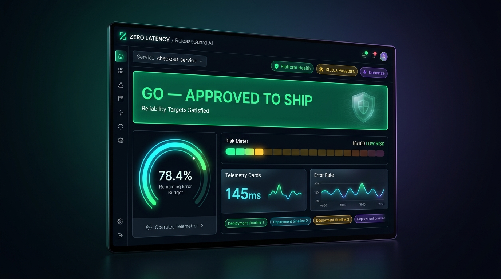

# SignalOps 🛡️

**AO-05: Is this release safe to ship right now?**

An AI-powered deploy-time risk dashboard and decision support system that brings reliability targets, error budgets, and change risk into the moment of release.



---

## Team Zero Latency | UG-42 | Domain: AI Ops

**Members:** Varala Vamsa Sarga · Meen Ren Tharquia · Debarek Jalmaltheerga · Ruth Vardalwati

---

## Project Structure

```
SignalOps/
├── frontend/     # Next.js 16 + TypeScript + Tailwind CSS dashboard
├── backend/      # Python FastAPI + Deterministic Risk Engine + LangChain agents
└── data-ml/      # Data processing, SLO formulas, ML risk model
```

---

## Quick Start

### 1. Backend (FastAPI + Risk Engine)
```bash
cd backend
python -m venv venv
venv\Scripts\activate
pip install -r requirements.txt
uvicorn main:app --reload
```
API Documentation & Interactive Swagger UI: `http://localhost:8000/docs`

### 2. Frontend (Next.js Dashboard)
```bash
cd frontend
npm install
npm run dev
```
Access the SignalOps dashboard at `http://localhost:3000`.

---

## Key Features
- **Deterministic Error Budget Engine**: Precise calculation of remaining error budget and burn rates against SLO/SLI metrics.
- **Multi-Factor Risk Scoring**: 0–100 risk score evaluated across change scope, latency deviation, incident history, and traffic windows.
- **Actionable Decision Support**: Clear `GO`, `GO WITH SAFEGUARDS`, or `WAIT` verdicts with plain-English rationales and safe window recommendations.
- **Advisory & Blameless**: Advisory-only (never auto-blocks), anonymises author metrics to avoid surveillance, and documents anti-gaming safeguards.
